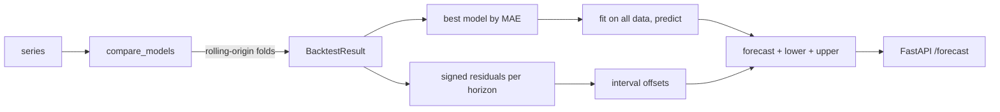

# forecastkit

A small forecasting toolkit I wrote to practise the part of forecasting that usually gets skipped:
evaluating a model honestly and saying how wrong it is likely to be. It has a handful of models,
a rolling-origin backtester, prediction intervals built from backtest residuals, and a FastAPI
service that picks the best model for a series and returns a forecast with an interval.

## Why this exists

Forecasts feed decisions such as how much stock to order or how many copies to print. A single
number is rarely enough for that. The decision depends on the cost of being too high versus too
low, so the useful output is a range with a known track record. Everything here is built around
that idea: refit at many origins, measure the real out-of-sample error per horizon step, and turn
those errors into intervals.

## Architecture



## Models

| name | idea |
| --- | --- |
| `naive` | repeat the last value |
| `seasonal_naive` | repeat the last full season |
| `drift` | extend the line from first to last point |
| `moving_average` | flat forecast at the recent mean |
| `holt_winters` | level, trend and additive seasonality, parameters chosen by grid search |
| `ridge_lag` | ridge regression on lagged values and a time index, forecast recursively |

## Setup

```bash
uv sync
uv run pytest
```

## Usage

Leaderboard on a synthetic monthly series:

```bash
uv run python -m forecastkit.cli --n 240 --season 12 --horizon 12
```

Run the API and request a forecast:

```bash
uv run uvicorn forecastkit.api:app --reload
uv run python -c "import json; from forecastkit.data import make_synthetic; print(json.dumps({'values': make_synthetic(120, season=12).tolist(), 'horizon': 6, 'season': 12}))" \
  | curl -s localhost:8000/forecast -H 'content-type: application/json' -d @-
```

The series has to be long enough for a few backtest folds, otherwise the API answers with a 422
explaining that the series is too short.

From Python:

```python
from forecastkit.data import make_synthetic
from forecastkit.service import forecast_series

out = forecast_series(make_synthetic(180, season=12), horizon=12, season=12, level=0.8)
print(out.model, out.forecast[:3], out.lower[:3], out.upper[:3])
```

## Design notes

- **Backtesting uses expanding windows and never looks ahead.** A test checks that the first
  forecast of every fold is built only from data before the origin.
- **Intervals come from signed residual quantiles per horizon step**, not a fixed Gaussian
  assumption. They can be asymmetric and tend to widen with the horizon. This is a simple
  split-conformal style approach and needs at least three folds.
- **Model choice is by MAE on the same folds for every model**, so the comparison is fair.
  The trade-off is cost: auto mode refits every model at every origin, so it is meant for
  series of a few thousand points at most. The API enforces a size cap for that reason.
- **Limitations.** Holt-Winters is additive only, the grid is coarse, and the ridge model does not
  use external regressors. Real demand data usually needs holidays and price or promotion
  features, which would be the natural next step.

## Tests

```bash
uv run ruff format --check . && uv run ruff check . && uv run mypy src && uv run pytest
```

## Docker

```bash
docker build -t forecastkit . && docker run -p 8000:8000 forecastkit
```
